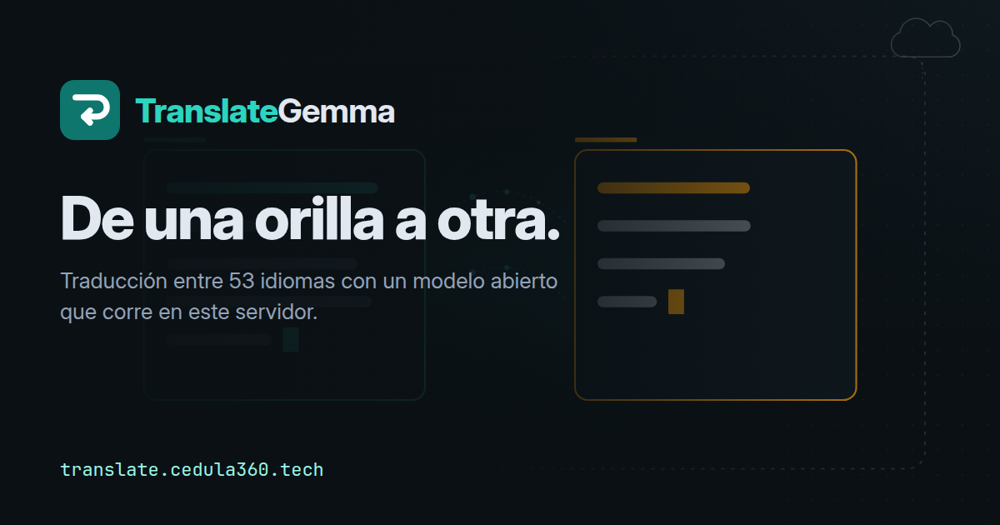

# TranslateGemma UI

<div align="center">
  

  <p align="center">
    <strong>Traducción entre 53 idiomas con el modelo abierto TranslateGemma, ejecutado con Ollama en tu servidor.</strong>
    <br />
    <a href="https://translate.cedula360.tech">translate.cedula360.tech</a> •
    <a href="docs/Manual_Marca_TranslateGemma/v1.0/README.md">Manual de Marca v1.0</a> •
    <a href="docs/rediseno-2026-10/README.md">Rediseño de octubre de 2026</a>
  </p>
</div>

> TranslateGemma y Gemma son marcas de Google. Este producto usa el modelo abierto TranslateGemma bajo los
> [términos de uso de Gemma](https://ai.google.dev/gemma/terms) y **no está afiliado a Google**.

---

## Qué es

La interfaz web de un modelo de traducción abierto: escribe o pega un texto, elige el par de idiomas y lee la
traducción mientras se genera. El modelo corre con **Ollama en el mismo servidor** que la página; el proxy
`/ollama` solo admite modelos locales, así que el texto no se envía a ningún proveedor de IA.

| Qué | Dónde se comprueba |
| :--- | :--- |
| **53 idiomas** en el selector (el modelo declara 55) | `frontend/src/lib/languages.ts` |
| Modelo por defecto **`translategemma:latest`** (4,3B, el único instalado en el VPS) | `frontend/src/services/ollama.ts` |
| **Traducción en directo** (streaming) y atajo **Ctrl/Cmd + Enter** | `services/ollama.ts`, `TranslationPanel.tsx` |
| **Imágenes**: el modelo instalado lee imágenes | `ImageTranslation.tsx` |
| **Historial** por usuario (con sesión), en PocketBase del servidor | `services/pocketbase.ts` |
| Acceso propio o **«Continuar con Cédula 360»** (con su 2FA); roles admin/viewer | `app/api/auth/cedula360`, `app/admin` |
| Proxy cerrado: solo modelos locales, 8 MB por petición, 30 traducciones/min por IP | `app/ollama/[...path]/route.ts` |

Lo que **no** hace: no funciona sin conexión (es un servicio web), no ofrece elegir 4B/12B/27B (hay un modelo
instalado) y no es una traducción oficial (es un borrador para revisar).

## Marca

Desde el 11-oct-2026 la identidad sale del [Manual de Marca v1.0 «De una orilla a otra»](docs/Manual_Marca_TranslateGemma/v1.0/README.md):
símbolo propio (una línea de texto que gira y vuelve traducida), paleta Jade con dos orillas (Agua y Ámbar),
Inter y JetBrains Mono autoalojadas. El build del manual copia tokens, fuentes, logos y escenas a
`frontend/public/marca/`. La identidad no imita a Google (ni su azul, ni sus colores, ni su icono de traducción).

## 🤝 Alianza Cédula 360

TranslateGemma UI es parte del ecosistema bajo `translate.cedula360.tech` (`translate.alexanderoviedofadul.dev` →
301): portada pública en `/`, la herramienta en `/traducir`, el panel `/admin` con RBAC y el login
**«Continuar con Cédula 360»**: Route Handlers de Next.js que validan servidor a servidor contra la API de Cédula 360
y su 2FA, con sesión vía PocketBase impersonate (usuario `viewer`, sin guardar la contraseña aliada) y reCAPTCHA v3
(se carga solo al abrir ese acceso). Detalle en [`docs/ALIANZA-CEDULA360-2026-05-16.md`](docs/ALIANZA-CEDULA360-2026-05-16.md).

### Despliegue

- Push a `main` → webhook (`translate-webhook.service`, `/root/scripts/webhook-server.js`) → `/root/scripts/webhook-translate-deploy.sh`.
- ⚠️ **Build y reinicio siempre juntos**, y nunca reiniciar sin `.next/BUILD_ID` ([incidente de mayo](docs/INCIDENTE-CHUNKLOADERROR-2026-05-28.md)).
- ⚠️ El build necesita las **devDependencies** (Tailwind, PostCSS, TypeScript): `npm install` con `NODE_ENV=production` no las instala y el build falla. Ver [`docs/rediseno-2026-10/README.md`](docs/rediseno-2026-10/README.md) §Despliegue.
- `OLLAMA_HOST` (en `/root/TranslateGemma-UI/.env`, fuera de git) debe apuntar al **Ollama local** (`http://127.0.0.1:11434`): el público exige token desde el 10-oct-2026.

---

## 🚀 Inicio Rápido

### Prerrequisitos

1.  Tener **[Ollama](https://ollama.com/)** instalado (o Docker).
2.  Tener al menos 8GB de RAM (para el modelo 4B, el que usa el VPS).
3.  Node.js >= 20 (para desarrollo).

### Instalación con Docker (Recomendado)

```bash
# 1. Clonar el repositorio
git clone https://github.com/alexanderoviedofadul/TranslateGemma-UI.git
cd TranslateGemma-UI

# 2. Iniciar todos los servicios (Frontend + Ollama + PocketBase)
docker compose up -d

# 3. Descargar el modelo de traducción (Esperar a que Ollama inicie)
docker exec -it translategemma-ui-ollama-1 ollama pull translategemma:latest

# 4. Acceder a la aplicación
open http://localhost:3000
```

### Desarrollo Local

```bash
# 1. Clonar e instalar dependencias
git clone https://github.com/alexanderoviedofadul/TranslateGemma-UI.git
cd TranslateGemma-UI/frontend
npm install

# 2. Configurar entorno
cp .env.local.example .env.local
# Editar .env.local con tus URLs de Ollama y PocketBase

# 3. Iniciar servidor de desarrollo
npm run dev

# 4. Abrir http://localhost:3000
```

---

## 🛡️ Recorrido y «Seguridad comprobada» (25-oct-2026)

- **https://translate.cedula360.tech/conozca/**: recorrido inmersivo de 7 capítulos (escenas, diapositivas y mapa),
  con las escenas del manual. Contenido en `frontend/conozca.json`.
- La portada muestra lo que dicen de este sitio herramientas públicas (W3C, WAVE, Observatory…), leído de
  `/salud-publica/publico.json`: ninguna cifra a mano.
- Detalle: [docs/seguridad-comprobada-y-recorrido-2026-10-25.md](docs/seguridad-comprobada-y-recorrido-2026-10-25.md).

## 📚 Documentación Técnica

Todo lo que necesitas saber sobre los modelos y la integración:

*   📖 **[Guía de Modelos](./docs/translategemma/MODELS.md)**: Los tamaños 4B, 12B y 27B que publica Google (en el VPS solo está el 4B).
*   🗣️ **[Lista de Idiomas](./docs/translategemma/LANGUAGES.md)**: Todos los códigos ISO soportados.
*   🤖 **[Guía de Prompts](./docs/translategemma/PROMPT_GUIDE.md)**: Cómo hablar con el modelo vía API.
*   📱 **[Análisis de Diseño UI](./docs/UI_DESIGN_COMPLIANCE_ANALYSIS.md)**: Desglose completo de la interfaz.
*   🗺️ **[Roadmap de Implementación](./docs/IMPLEMENTATION_ROADMAP.md)**: Estado actual del desarrollo.
*   🚀 **[Webhook & Deployment](./docs/WEBHOOK-DEPLOYMENT.md)**: Pipeline de despliegue automático (build limpio + restart).
*   🩺 **[Troubleshooting](./docs/TROUBLESHOOTING.md)**: Problemas comunes y soluciones (incl. `ChunkLoadError` / CSS 500).
*   🎨 **[Manual de Marca v1.0](./docs/Manual_Marca_TranslateGemma/v1.0/README.md)** y **[Rediseño 2026-10](./docs/rediseno-2026-10/README.md)**.

---

## 🛠️ Arquitectura

El proyecto utiliza una arquitectura moderna y desacoplada:

| Capa | Tecnología | Versión |
| :--- | :--- | :--- |
| **Frontend** | Next.js + React + TypeScript | 16.x / 19.x |
| **Styling** | Tailwind CSS | 4.x |
| **State** | Zustand | 5.x |
| **Backend/Auth** | PocketBase | 0.24+ |
| **LLM Runtime** | Ollama | Latest |
| **Modelo** | TranslateGemma (Google DeepMind), modelo abierto | `translategemma:latest` (4,3B) |

---

## 🤝 Contribuir

¡Las contribuciones son bienvenidas! Especialmente en:
*   Traducción de la interfaz.
*   Optimización de prompts para casos de borde.
*   Adaptadores para nuevos modelos.

---

<div align="center">
  <sub>Desarrollado con ❤️ para la comunidad Open Source.</sub>
</div>
